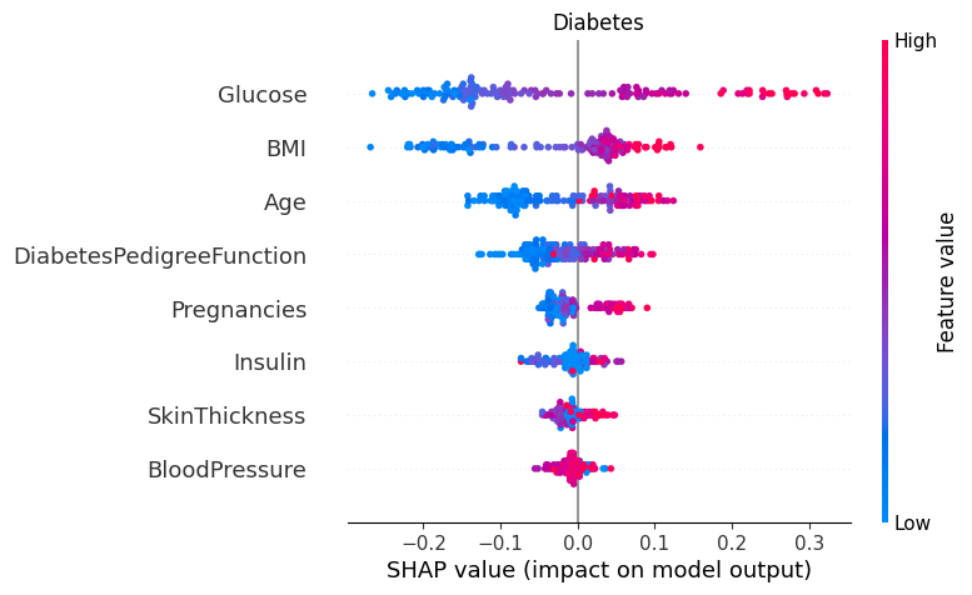
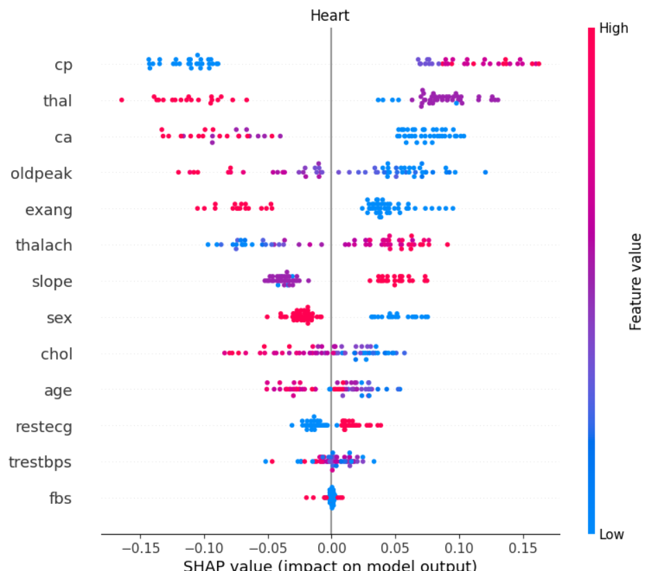
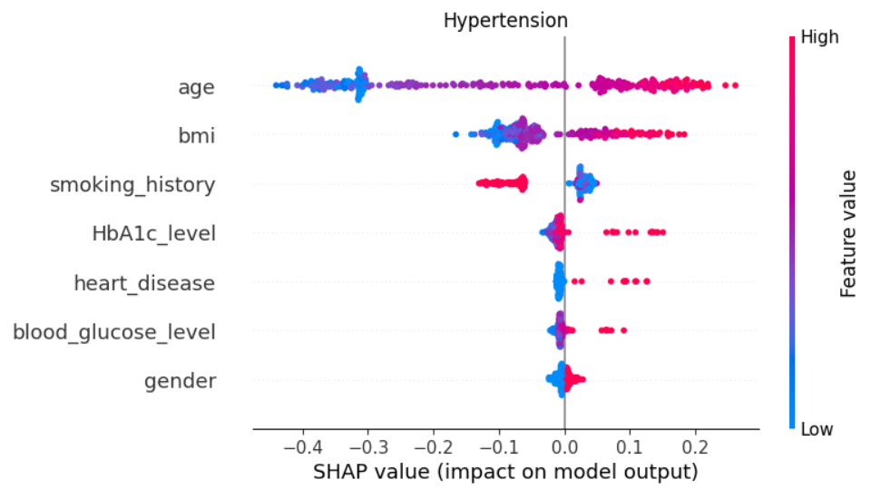
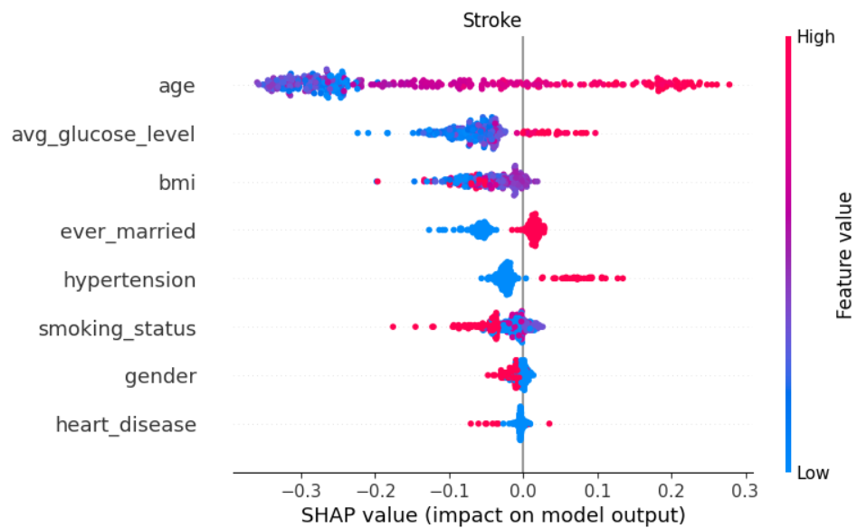

# AI-Based Personalized Health Risk Assessment System

One web form that estimates your risk of **Diabetes, Heart Disease, Hypertension and Stroke**, using four Random Forest models, with a per-prediction SHAP explanation.

**Live demo:** https://health-risk-assessment.streamlit.app

> **Disclaimer:** this is an awareness tool that gives a risk estimate only. It is not a medical diagnosis. Please consult a doctor for any health concern.

**Major Project (Phase I), B.Tech CSE, IILM University, Greater Noida (Session 2026–27)**
**Team:** Anant Raj (group leader), Aadesh Agarwal, Abhinav Sahai Kamthan, Divyansh Saxena
**Guide:** Ms. Yamini Singh, Assistant Professor, School of CSE

---

## Features

- **One form, four predictions:** enter your health details once instead of filling four separate forms.
- **Risk gauges and a probability score** for each disease, with a comparison chart.
- **SHAP explanations:** see which factors pushed each prediction up or down.
- **Website with 5 pages:** Home, Risk Assessment, Model Performance, Explainability, About.

## Models and datasets

Each disease has its own Random Forest model (scikit-learn: 300 trees, max depth 8, balanced class weights), trained on an 80/20 stratified split with `random_state=42`.

| Disease | Dataset | Inputs used |
|---|---|---|
| Diabetes | Pima Indians Diabetes Database | The dataset's 8 clinical features |
| Heart Disease | UCI Cleveland Heart Disease | The dataset's 13 clinical features |
| Hypertension | Diabetes prediction dataset (100,000 records, diagnosed hypertension label) | Gender, age, heart disease, smoking history, BMI, HbA1c, blood glucose |
| Stroke | Healthcare stroke dataset | Gender, age, hypertension, heart disease, marital status, average glucose, BMI, smoking status |

> In the heart dataset, label 0 means heart disease and 1 means no disease. The app accounts for this.

## Results (20% held-out test data)

| Disease | Accuracy | ROC-AUC | Recall (positive class) |
|---|---|---|---|
| Diabetes | 75.97% | 0.829 | 0.65 |
| Heart Disease | 81.97% | 0.906 | 0.64 (disease class) |
| Hypertension | 65.52% | 0.816 | 0.83 |
| Stroke | 86.86% | 0.787 | 0.26 |

Accuracy alone is misleading for rare conditions: only 7.5% of the hypertension data and 4.3% of the stroke data are positive cases. Recall and ROC-AUC are the better guides, and precision for hypertension (0.16) and stroke (0.10) is low, so these two models should be read as screening aids.


### Model comparison and imbalance handling

Random Forest was compared with Logistic Regression and XGBoost, and with SMOTE oversampling and threshold tuning on the Random Forest.


### Explainability (SHAP)

| Diabetes | Heart Disease |
|---|---|
|  |  |

| Hypertension | Stroke |
|---|---|
|  |  |

## Run it locally

```bash
git clone https://github.com/Anant6125/AI_Based_Personalized_Health_Risk_Asseament_System
cd AI_Based_Personalized_Health_Risk_Asseament_System
pip install -r requirements.txt
streamlit run streamlit_app.py
```

To retrain the four models (downloads the datasets and overwrites the `.pkl` files):

```bash
python train_all.py
```

## Repository contents

| File | Description |
|---|---|
| `streamlit_app.py` | Full 5-page website (this is the live app) |
| `app.py` | Earlier single-form version of the app |
| `train_all.py` | Trains the four Random Forest models and saves them |
| `diabetes_model.pkl`, `heart_model.pkl`, `hypertension_model.pkl`, `stroke_model.pkl` | Trained models |
| `shap_images/` | SHAP summary plots for each disease |
| `colab metrics.png`, `imbalance handling aur model comparison.png` | Evaluation results from Google Colab |
| `PHASE-1 Final Report.pdf`, `PHASE-1 Plag Report.pdf` | Phase-I project report and plagiarism report |
| `Project Poster.pdf` | Project poster |
| `Healthy (low risk) data result.pdf`, `Risky (High Risk) data result.pdf` | Sample outputs for a low-risk and a high-risk input |
| `requirements.txt` | Python dependencies |

## Limitations

- The four datasets are small or public research datasets, so results may not carry over to the general population.
- The models use only the few basic factors listed above and no lab or imaging data.
- Stroke and hypertension are heavily imbalanced, so false positives are common.

## Tech

Python · scikit-learn · Random Forest · SHAP · XGBoost · Streamlit · Plotly · pandas · NumPy

## Author

**Anant Raj**, B.Tech CSE, IILM University, Greater Noida
GitHub: [Anant6125](https://github.com/Anant6125) · LinkedIn: [anant-raj](https://linkedin.com/in/anant-raj-29033131a)
